# 🛒 Cartly — Grocery Delivery System

**Cartly** is a full-featured grocery e-commerce web application built with **Django**. It lets customers browse groceries by category, add them to a cart, and place orders — while admins get a dedicated dashboard to manage products and process customer orders.

---

## ✨ Features

### 👤 Customers
- Browse the shop with **16 product categories** (Fruits, Vegetables, Dairy, Bakery, Beverages, Snacks, and more)
- View detailed product pages with images, prices (MRP vs. offer price), and descriptions
- **Add / remove items** from a personal cart
- **Place orders** and track their status (Pending / Accepted / Declined)
- View complete **order history**
- User registration & login with session-based authentication

### 🛠️ Admins
- Dedicated **admin dashboard** with recent orders at a glance
- **Add, edit, and delete** products (with image upload)
- **Manage all customer orders** and update their status
- Role-based access control — admin-only pages are protected

---

## 📸 Screenshots

### Shop (Landing Page)
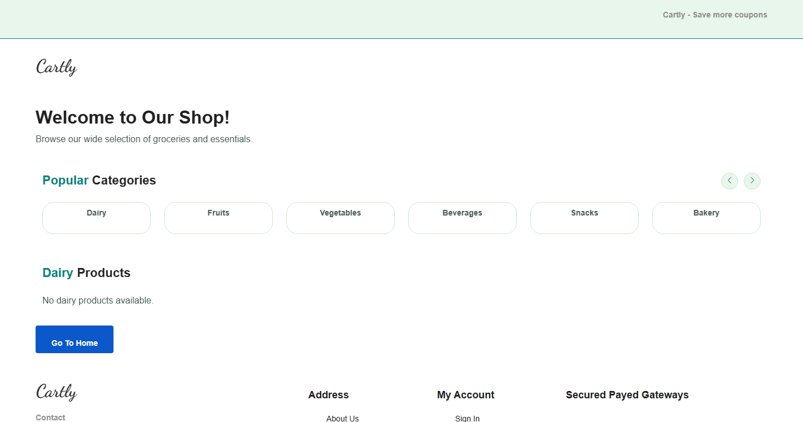

### Login & Registration
| Login | Register |
| --- | --- |
| 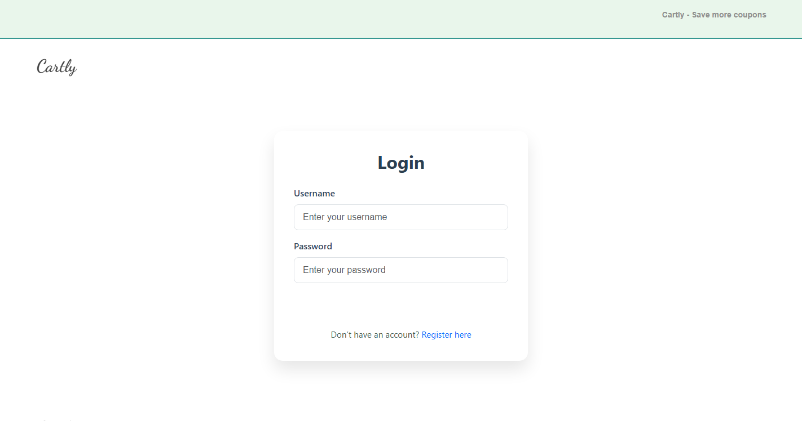 | 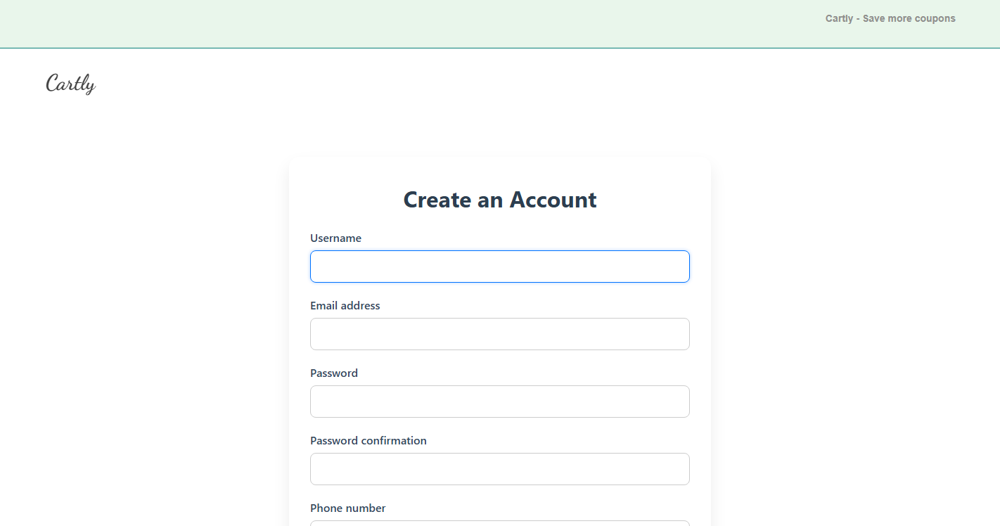 |

### Product Detail & Category Browsing
| Product Detail | Category Page |
| --- | --- |
| 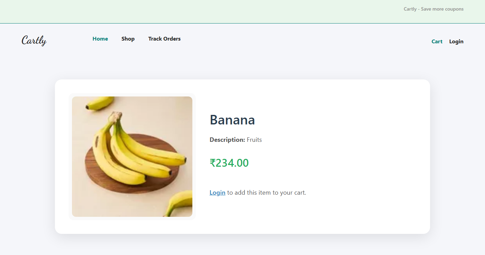 | 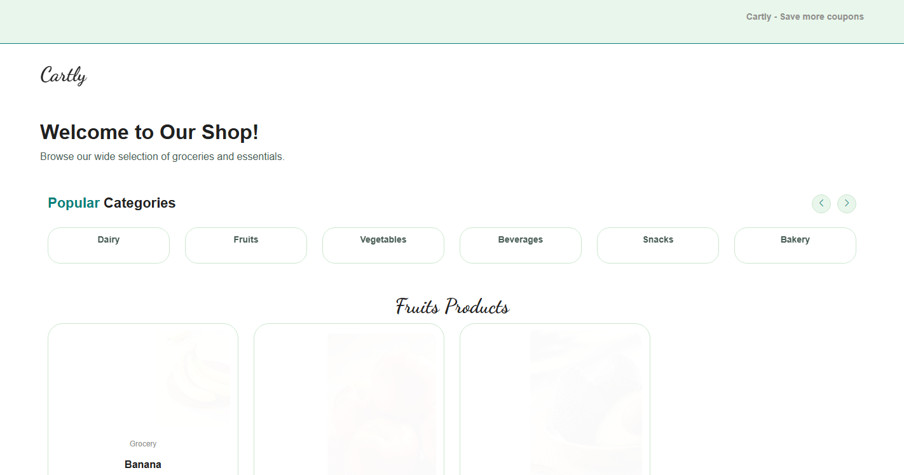 |

### Admin Dashboard
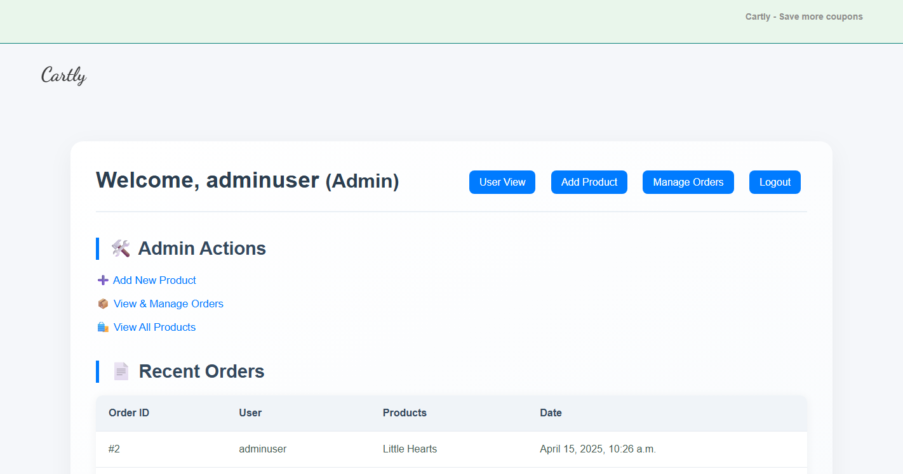

### Product Dashboard (User View)
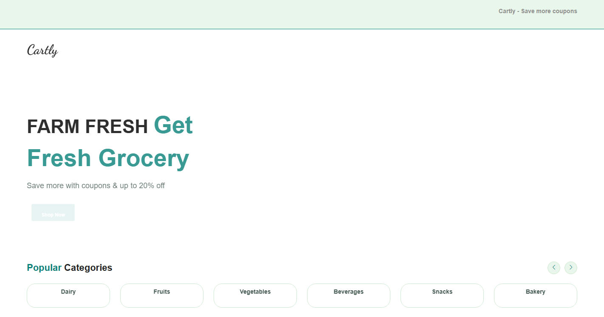

### Shopping Cart & Order History
| Cart | Order History |
| --- | --- |
| 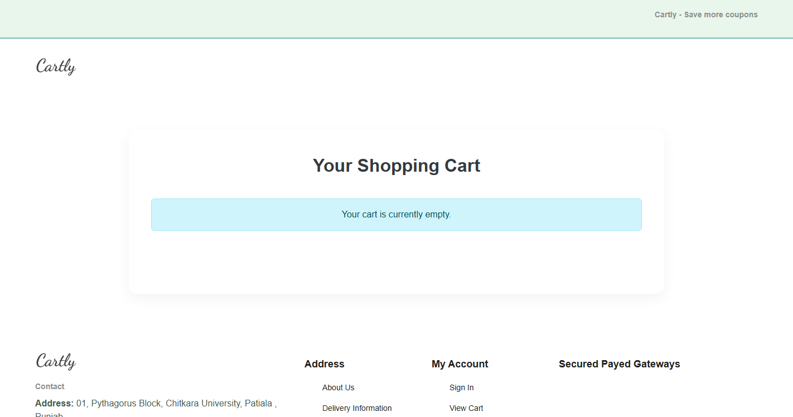 | 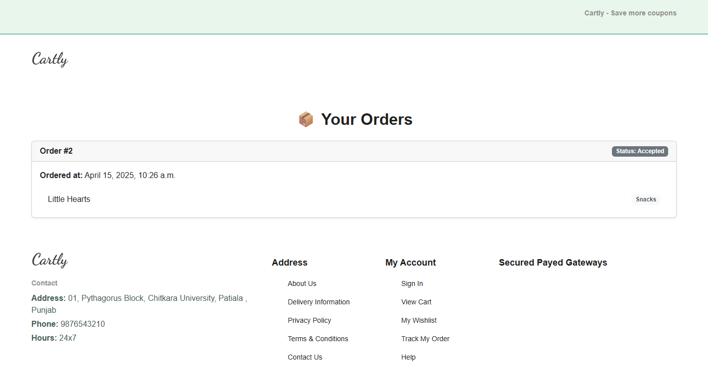 |

### Order Management & Add Product (Admin)
| Manage Orders | Add Product |
| --- | --- |
| 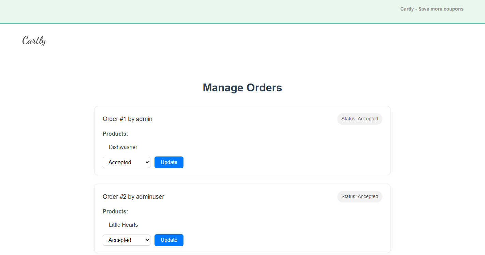 | 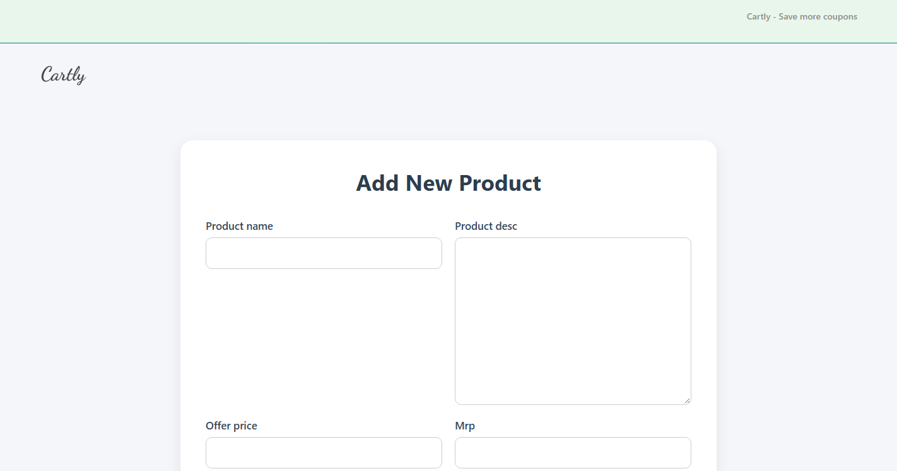 |

---

## 🧰 Tech Stack

| Layer | Technology |
| --- | --- |
| Backend | Python 3, Django 4.2 |
| Database | SQLite 3 |
| Frontend | HTML, CSS, Bootstrap, Django Templates |
| Media / Images | Pillow (product image uploads) |

---

## 📂 Project Structure

```
realApp/
├── manage.py                  # Django management script
├── requirements.txt           # Python dependencies
├── db.sqlite3                 # SQLite database (not committed)
├── media/                     # Uploaded product images
│   └── products/
├── docs/
│   └── screenshots/           # Application screenshots (used in README)
├── realApp/                   # Project configuration
│   ├── settings.py            # Django settings
│   ├── urls.py                # Root URL configuration
│   └── wsgi.py / asgi.py
├── MainApp/                   # Main application (products, cart, orders)
│   ├── models.py              # Products, Cart, Order models
│   ├── views.py               # Views for shop, cart, orders, admin
│   ├── urls.py                # App routes
│   ├── forms.py               # Product & order forms
│   ├── admin.py               # Django admin registration
│   ├── templates/             # HTML templates
│   └── static/                # Static assets (logo, etc.)
└── users/                     # User management application
    ├── models.py              # CustomUser model (user/admin roles)
    ├── forms.py               # Registration form
    ├── views.py               # Register / login / profile views
    └── templates/users/       # User-related templates
```

---

## 🚀 Getting Started

### Prerequisites
- Python 3.10+

### 1. Clone the repository
```bash
git clone https://github.com/Akshat-hub7/GroceryStore.git
cd GroceryStore
```

### 2. Create & activate a virtual environment
```bash
python -m venv venv

# Windows
venv\Scripts\activate

# macOS / Linux
source venv/bin/activate
```

### 3. Install dependencies
```bash
pip install -r requirements.txt
```

### 4. Apply database migrations
```bash
python manage.py makemigrations
python manage.py migrate
```

### 5. Run the development server
```bash
python manage.py runserver
```

Then open **http://127.0.0.1:8000/** in your browser. 🎉

---

## 🔑 Demo Accounts

The application includes a built-in demo admin account (defined in `users/models.py`):

| Role | Username | Password |
| --- | --- | --- |
| Admin | `adminuser` | `supersecret123` |
| Customer | *register your own account* via the **Register** page | — |

> ⚠️ **Note:** Anyone logging in with the `adminuser` credentials automatically gets admin rights. For production use, remove the hardcoded credentials from `users/models.py` and use Django's `createsuperuser` command instead.

---

## 🗺️ Key URLs

| URL | Description | Access |
| --- | --- | --- |
| `/` | Shop / landing page | Public |
| `/product/<id>/` | Product detail page | Public |
| `/category/<slug>/` | Filter products by category | Public |
| `/login/`, `/register/` | Authentication | Public |
| `/dashboard/` | User product dashboard | Logged in |
| `/cart/` | View shopping cart | Logged in |
| `/place-order/` | Place order from cart | Logged in |
| `/orders/` | Order history | Logged in |
| `/admin-dashboard/` | Admin overview | Admin only |
| `/add-product/` | Add a new product | Admin only |
| `/manage-orders/` | Manage customer orders | Admin only |

---

## 👥 Authors

- **Akshat** — [Akshat-hub7](https://github.com/Akshat-hub7)

## 📄 License

This project is available for educational and personal use.
